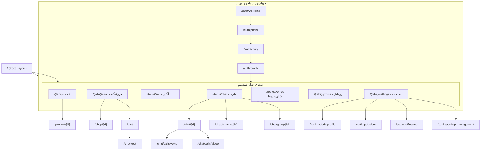
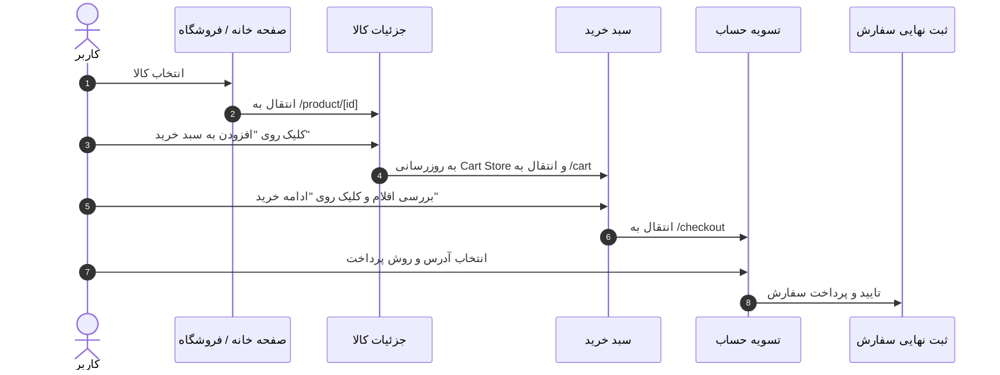
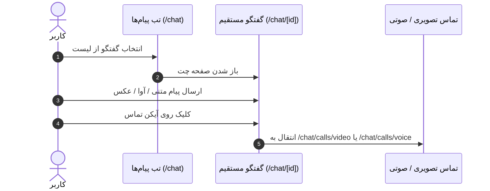

# 03. Navigation and User Flows — ساختار ناوبری و جریان‌های کاربر

این مستند ساختار ناوبری، پشته صفحات (Navigation Stack)، رفتارهای دکمه بازگشت (Back Navigation)، تب‌ها و جریان‌های کاری اصلی کاربر را با استفاده از نمودارهای **Mermaid** توضیح می‌دهد.

---

## 🗺️ ساختار کلی ناوبری (Screen Hierarchy)

پروژه از **Expo Router** (مبتنی بر React Navigation Stack & Tabs) استفاده می‌کند.

---

## 🛒 جریان خرید و پرداخت (E-Commerce Flow)

---

## 💬 جریان گفتگو و پیام‌رسانی (Messaging Flow)

---

## 🔙 رفتار دکمه بازگشت (Back Stack & Hardware Back)
- **در Android:** فشار دادن دکمه Hardware Back یا Swipe Back روی صفحات فرزند، کاربر را به صفحه قبلی Stack برمی‌گرداند.
- **در تب‌های اصلی (`/(tabs)`):** فشار دادن دکمه Back در سایر تب‌ها، کاربر را به تب اصلی (`خانه / (tabs)`) هدایت کرده و در تب خانه، برنامه را مینیمایز می‌کند.
- **در مودال‌ها و BottomSheetها:** دکمه Back ابتدا مودال یا Sheet باز را می‌بندد.
